# AI Portfolio Builder

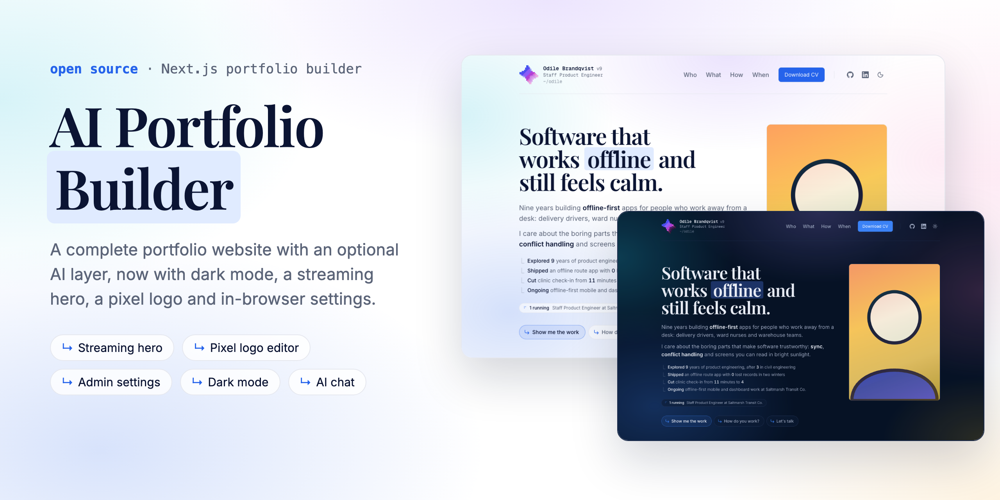

**An open source portfolio website for developers and designers, with an optional AI layer that answers questions about your work from your own content.**

This is a fork of [Mehmet Mutlu's AI Portfolio Builder](https://github.com/mutlumehmet/ai-portfolio-builder). It keeps everything the original does and adds a new look, motion, a pixel logo with its own editor, a blog, and settings you can change in the browser. The sample persona, Odile Brandqvist, and everything about her are fictional.

* [What it does](#what-it-does): the template this fork is built on
* [What this version adds](#what-this-version-adds): dark mode, the streaming hero, the pixel logo, settings in the admin, a blog and more
* [Set it up](#set-it-up): one click, one command, or your coding agent

## What it does

A complete portfolio site that works on its own, plus an AI layer you can switch on.

* **Every page a portfolio needs.** Home, selected work with filters, project case studies built from content blocks (text, images, code, video and embeds), side projects, an experience timeline, a FAQ and a CV download. Phone, tablet and desktop layouts.
* **An admin panel.** Edit projects, tags, FAQs and experience at `/admin`, without touching code. Coding agents can add and remove projects with a JSON file.
* **Start from your LinkedIn, CV and GitHub.** The import drafts your profile, experience, projects and FAQs with your own AI key, and shows you a summary before anything is written. It never invents facts.
* **An optional AI layer.** A chat that answers questions about your work, a job-fit check for recruiters, and a remote MCP server, all answering only from your own content through pgvector search. Works with OpenAI, Anthropic, Gemini, OpenRouter, Ollama or any OpenAI-compatible provider.
* **Ready to deploy.** One-click deploy to Vercel with a free Neon database. The first build creates the tables, loads the sample content and builds the search index.
* **The boring parts, done.** Admin sessions and login limits, per-IP rate limits on every AI endpoint, SEO and share images, colour themes and feature flags.

## What this version adds

### A hero that answers like an AI chat

The home page opens like a chat answer: a "Thinking…" status, then the headline and intro stream in word by word while the photo "prints" from noise. An agent-style activity log counts its numbers up, a "1 running" chip shows the current role, and follow-up chips sit underneath like suggested replies. Nothing shifts as it grows. It plays only on a full page load; back and forward, and visitors who prefer reduced motion, see everything at once.

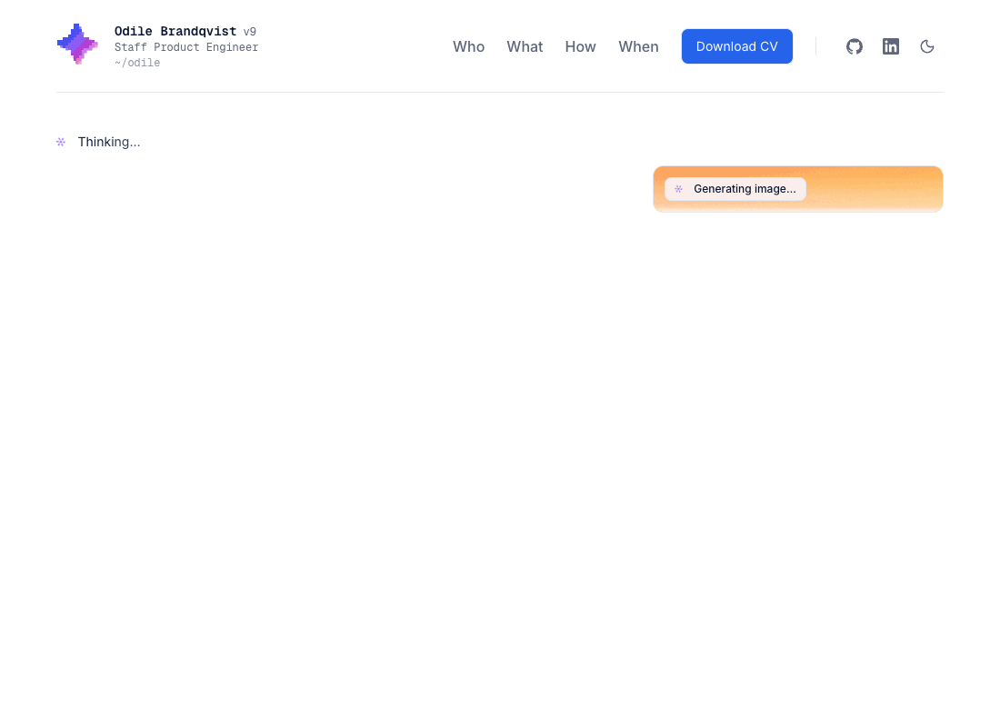

Section headings on the home page answer the same way, with a thinking verb ("Retrieving…", "Recalling…") before the heading streams in.

### Dark mode and a minimal look

Light borders, soft colour glows behind each page, serif headings, and an optional dark palette that follows the visitor's system setting, with a switch in the header. New themes: `gradient` (the default), `gradientDark` and `clay`.

<table>
<tr>
<td width="50%">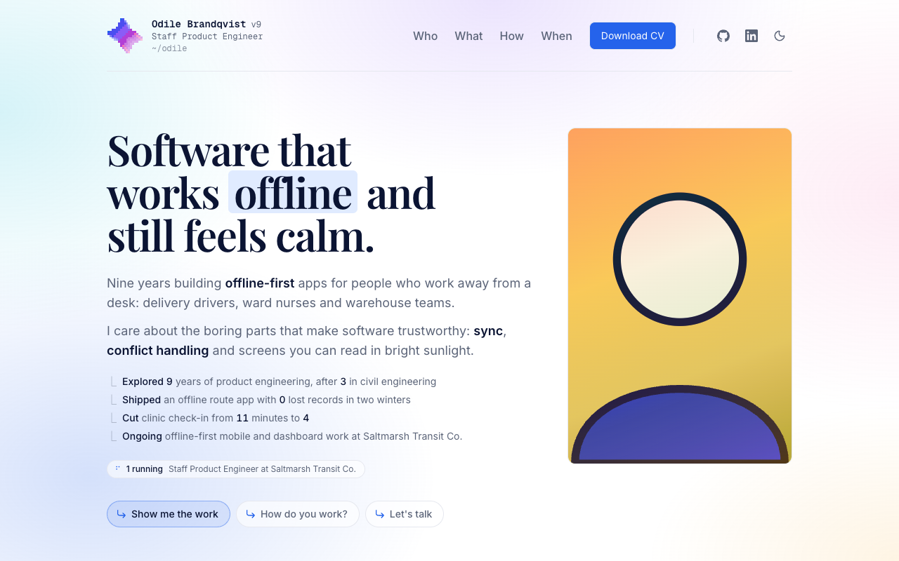</td>
<td width="50%">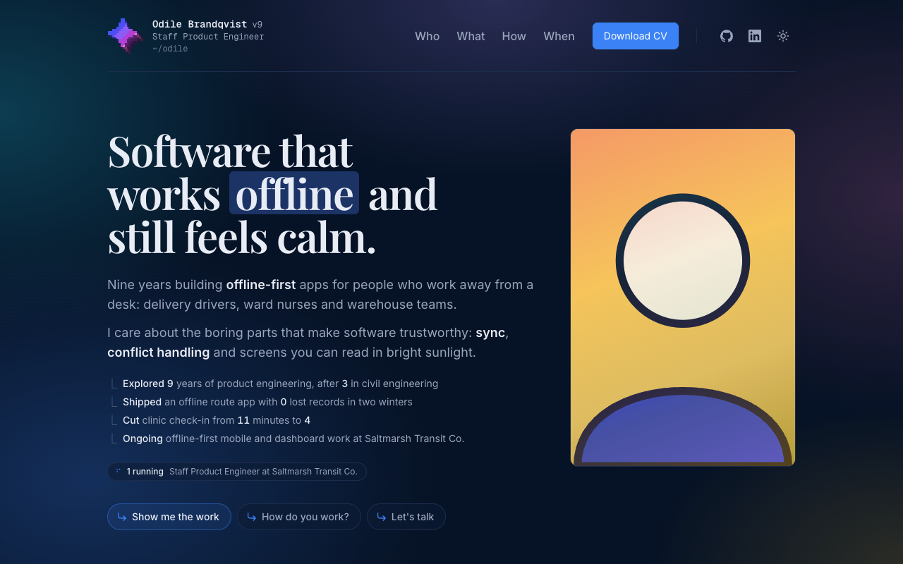</td>
</tr>
</table>

### A pixel logo, with an editor

A pixel-art mark drawn from a few rows of `#` and a list of colours that step diagonally across it, extruded with an animation on load and on hover. The favicon, the app icons and the share image are generated from it. Draw it in `/admin/settings/logo`: click or drag over the grid, pick the colours and the depth, and check the light, dark and header-size previews.

<table>
<tr>
<td width="60%">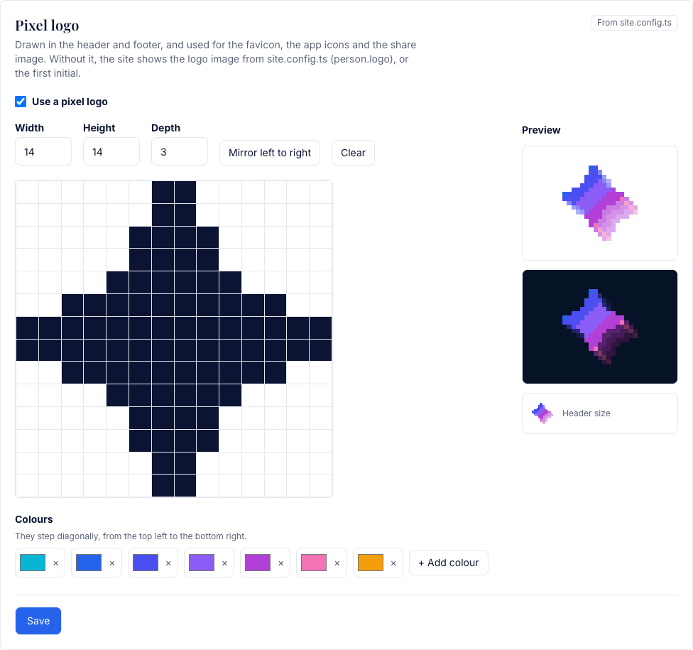</td>
<td width="40%">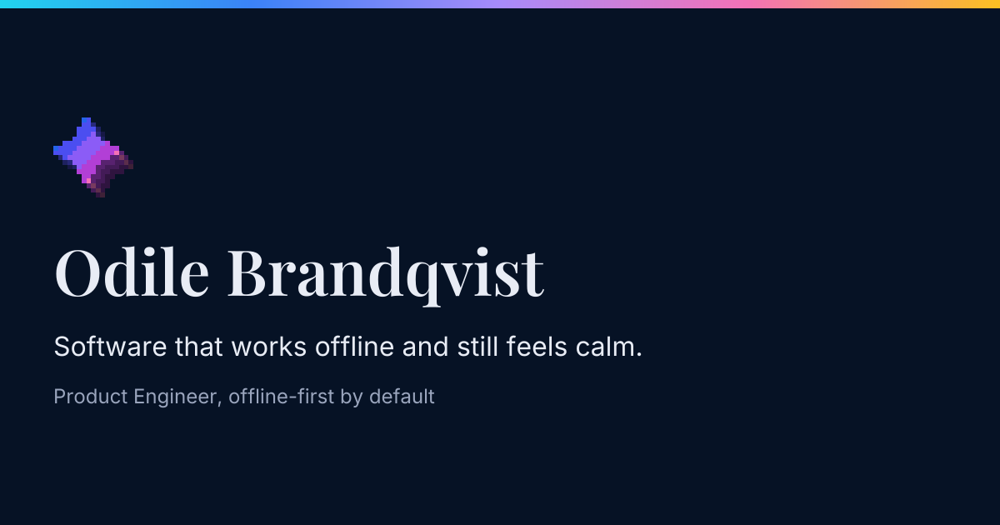</td>
</tr>
</table>

### Settings in the admin

`/admin/settings` edits what used to live only in `site.config.ts`: the hero, the home sections (impact stats, why the journey matters, the journey), How I work, systems and credentials, the stack order, the About page, the session block beside the logo, the footer and the feature flags. Saved values are stored in the database and override the file, which stays the default; every section can be reset to it. Lists can be reordered, and every save is checked before it is stored.

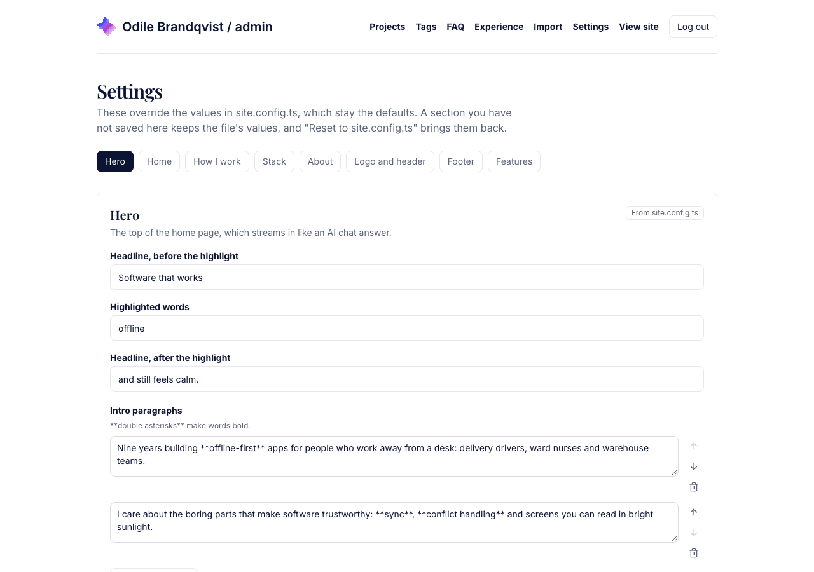

### FAQ as a chat

Each question has a play button. Press it and the answer streams in after a short "Accordioning…" status; the stop button folds it away again.

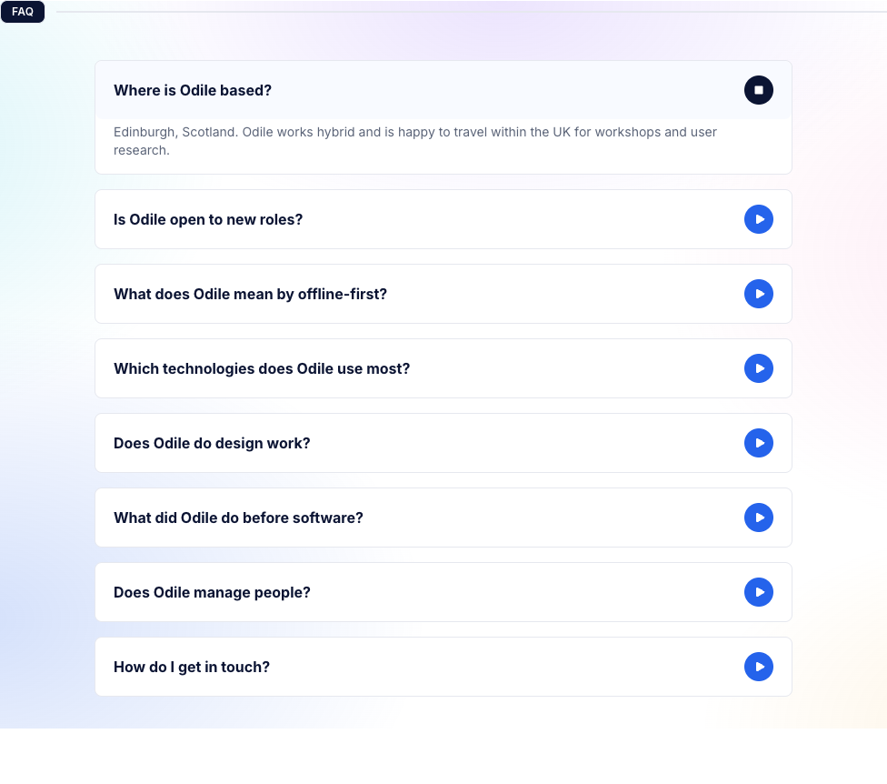

### About and How I work

Two new pages. **How I work** (`/how-i-work`) lists working habits, each with the case study that proves it; the home page shows the first four. **About** (`/about`) has the biography, the career in steps, and certificates and education. The home page also gets "Why the journey matters", systems and credentials, and a stack you can order and filter.

<table>
<tr>
<td width="50%">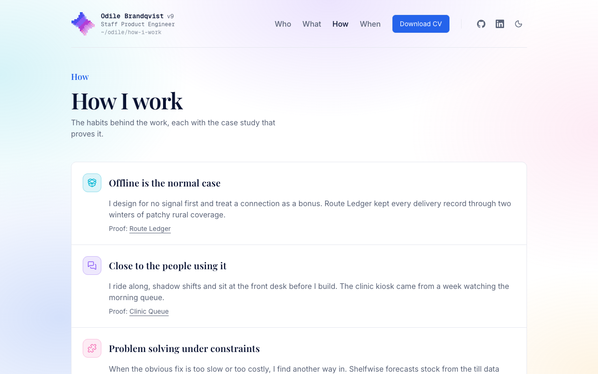</td>
<td width="50%">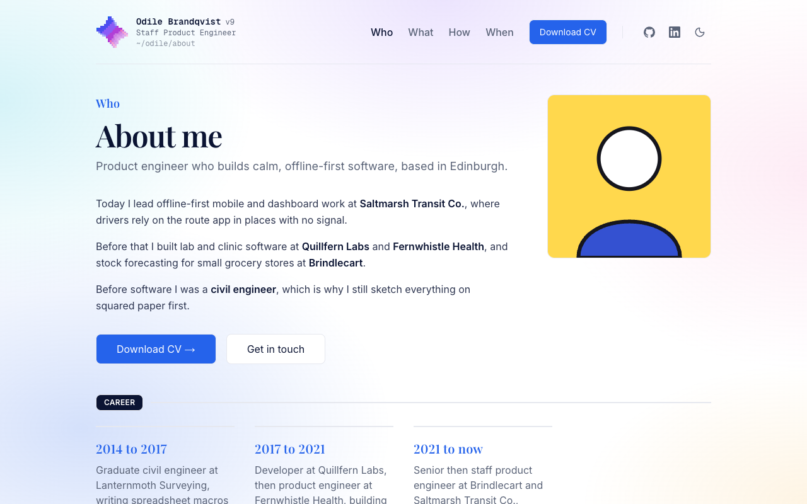</td>
</tr>
</table>

### A blog, with a real editor

Off until you switch it on (`blog` in [Feature flags](#feature-flags)), so you can write first.

* **Writing** (`/admin/posts`): a WYSIWYG editor (Milkdown) that stores Markdown, with a `/` menu, tables, code, images and YouTube videos. Drafts, publish and unpublish, tags, a live preview card, and ⌘S to save.
* **Images** from your computer, pasted or dropped in. They are resized and stored in your database, so there is no file storage to set up. A post without a cover gets a pixel pattern in your theme's colours.
* **For readers:** `/blog`, post pages, RSS, a share image per post, canonical links and `BlogPosting` data. Published posts also go into the sitemap, `llms.txt` and the chat's knowledge.
* **LinkedIn:** copy the article formatted for LinkedIn's editor, with its images one by one. Save the article's link and the post ends with a "Comment on LinkedIn" box. (LinkedIn has no API for publishing articles, so this part is copy and paste.)
* **AI drafts and covers** (optional): a draft from your own notes and your site's content, which marks what it doesn't know as `[TODO]`; a post with a `[TODO]` can't be published. Covers work with OpenRouter. Both spend your provider's credit, only when you click. They can take a minute: on Netlify, which stops a function sooner than Vercel, a slow one may be cut off after the provider has charged for it. A cover on another site is shown on the blog, but the share image then uses the pixel pattern.
* **From a file:** `npm run post:draft -- post.md` saves a Markdown file as a draft.
* **From Claude Code** (optional): a private MCP server that writes drafts. It has no tool to publish, so a person always reads the post first. See [Write posts from Claude Code](#write-posts-from-claude-code).

<table>
<tr>
<td width="50%">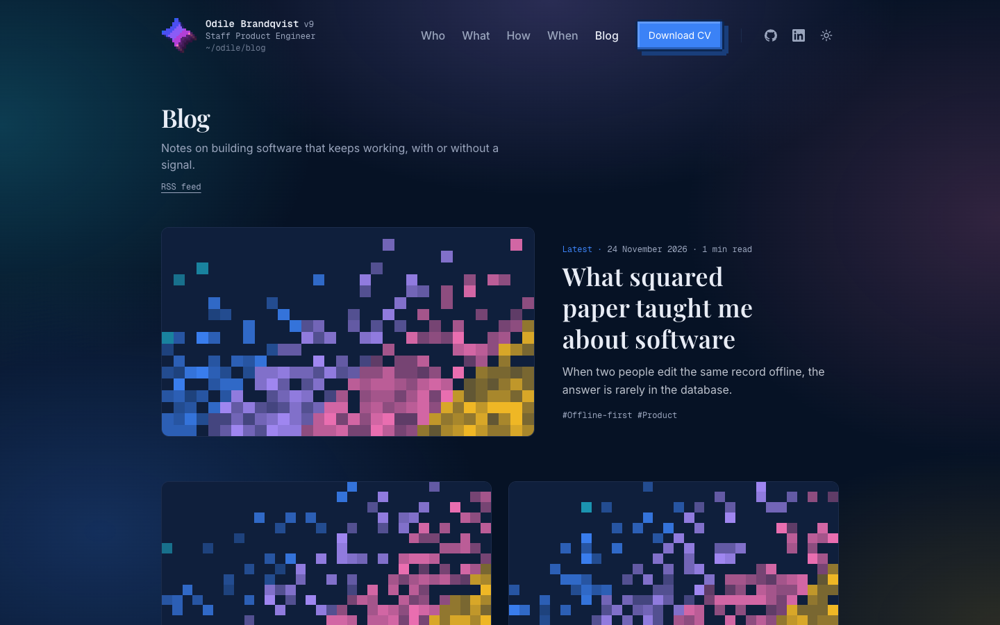</td>
<td width="50%">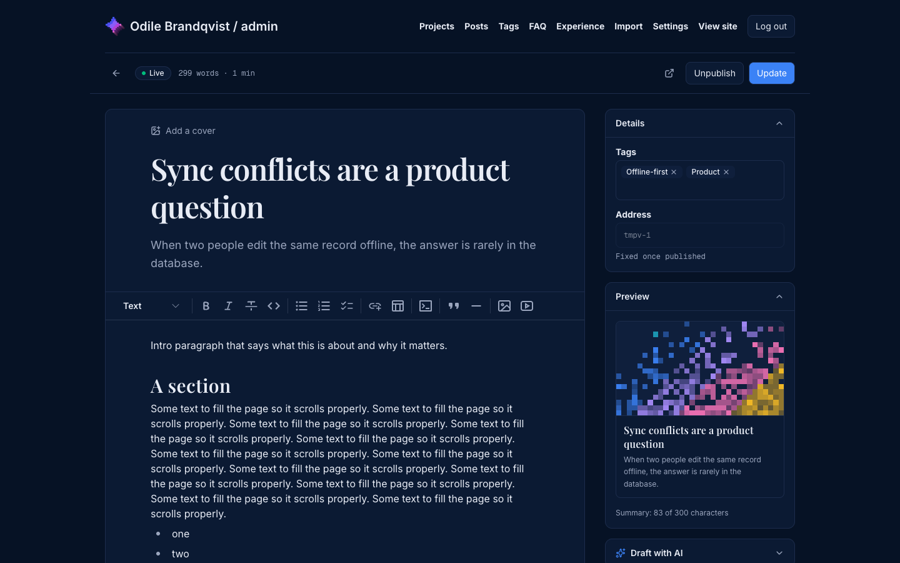</td>
</tr>
</table>

### And also

* **Pixel buttons** that match the logo, and a full-screen hero on desktop with a scroll hint, readable streaming and a photo that starts blurred. While the hero plays, the header shows only the logo.
* **Email links that always do something.** When no mail app opens, the address is copied and a note says so.
* **Project banners.** A project with `logo.svg` or `logo.png` (and an optional `logo-dark` variant) in `public/projects/<slug>/` opens with its logo on a soft gradient; others open with a cropped cover.
* **A session block.** Beside the logo, terminal-style lines: name and version, the role, and a working directory that follows the page (`~/odile/projects`).
* **For AI agents.** `/llms.txt` (a map of the site), `/llms-full.txt` (every page as one Markdown file) and `/agents.md` (how to use and cite them), ProfilePage structured data, `robots.txt` and `sitemap.xml`.
* **Vercel and Netlify.** 5-minute CDN caching for public pages on both, one minute for anything that lists posts. For Netlify, also a `netlify.toml`, a purge on every admin save, and a fix for the HTML comment Netlify adds to `<head>`.
* **PostHog analytics**, off until `NEXT_PUBLIC_POSTHOG_KEY` is set, proxied through the site, with `/admin` never tracked.
* **Accessibility:** a `<main>` landmark on every page, and reduced motion respected everywhere.

## Set it up


All three can start from your LinkedIn profile, CV and GitHub: the draft is made by your own AI provider and key (OpenAI, Claude, Gemini and others) or your own coding agent, and you review it before anything is written (see [Import from LinkedIn, CV and GitHub](#import-from-linkedin-cv-and-github)).

**A. Deploy with Vercel, no code**

[](https://vercel.com/new/clone?repository-url=https%3A%2F%2Fgithub.com%2Fbybash%2Fai-portfolio-builder&project-name=my-portfolio&repository-name=my-portfolio&env=AI_API_KEY%2CADMIN_PASSWORD%2CSESSION_SECRET&envDescription=An%20AI%20API%20key%20%28works%20with%20OpenAI%20by%20default%3B%20for%20another%20provider%20set%20AI_BASE_URL%20and%20CHAT_MODEL%20after%20deploy%29%2C%20a%20password%20for%20%2Fadmin%2C%20and%20any%20long%20random%20string%20to%20sign%20the%20admin%20session.&envLink=https%3A%2F%2Fgithub.com%2Fbybash%2Fai-portfolio-builder%23environment-variables&stores=%5B%7B%22type%22%3A%22integration%22%2C%22protocol%22%3A%22storage%22%2C%22integrationSlug%22%3A%22neon%22%2C%22productSlug%22%3A%22neon%22%7D%5D)

Copies the repo to your GitHub, creates a free Neon database, asks for three values and deploys; the first build sets up the tables, sample content and search index. Then open `/admin/import` on your new site to draft your content from LinkedIn, a CV and GitHub. Details in [Deploy in one click](#deploy-in-one-click). Netlify works too: see [Deploy to Netlify](#deploy-to-netlify).

<p align="center"><b>or</b></p>

**B. One command on your machine**

```bash
git clone https://github.com/bybash/ai-portfolio-builder.git my-portfolio
cd my-portfolio && npm install && npm run setup
```

Offers to import from your LinkedIn, CV and GitHub first, then asks for your name, links, colour theme, database and AI provider (OpenAI, Anthropic, Gemini, OpenRouter, Ollama or another OpenAI-compatible one), writes your config and `.env`, sets up the database and starts the site at http://localhost:3000.

<p align="center"><b>or</b></p>

**C. Ask your coding agent**

Open the cloned folder in Claude Code, Codex or another coding agent and paste:

```text
Set up this AI Portfolio Builder for me. Read README.md and AGENTS.md first, then follow
"Setting the site up for a new owner" in AGENTS.md. Start by asking me for my LinkedIn URL,
CV file and GitHub username, draft my content from them without inventing anything, and
show me the summary before you write. Then ask me what is missing a few questions at a
time, fill everything in, load it, and start the site so I can check it.
```

The agent reads your LinkedIn, CV and GitHub, shows you a draft, asks for anything missing, fills in the config, replaces the sample content with yours and loads it with the project scripts.

## What's inside

The portfolio is a full site on its own. These are its pages, shown with the sample content.

<table>
<tr>
<td valign="top" width="50%">
<a href="src/app/projects/page.tsx">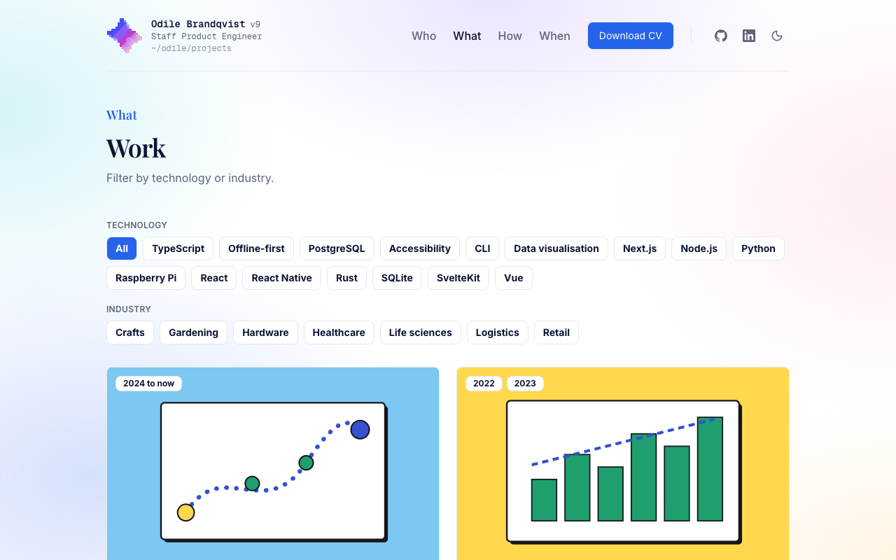</a><br>
<b>Selected work</b> (<code>/projects</code>): every project as a card with its cover and tags, paid work first. Visitors filter by technology or industry.
</td>
<td valign="top" width="50%">
<a href="src/app/projects/%5Bslug%5D/page.tsx">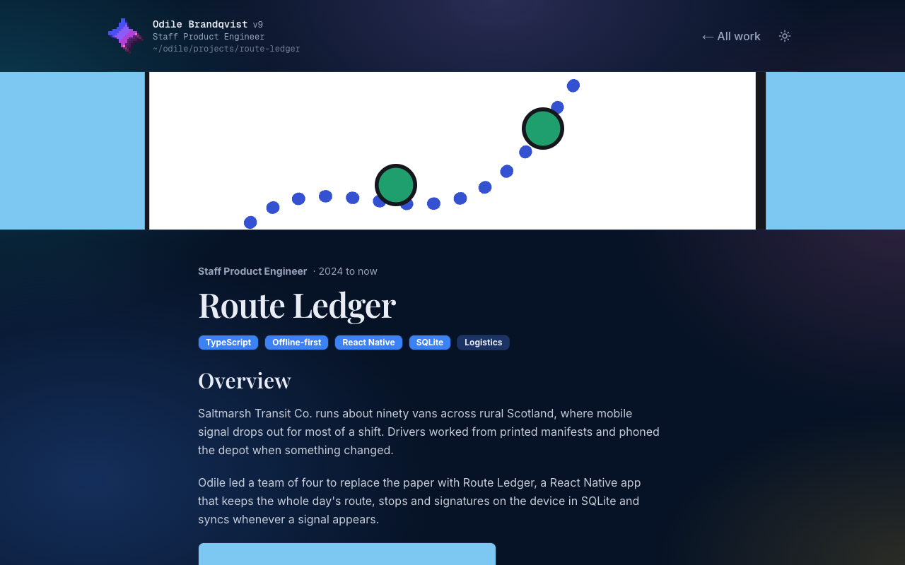</a><br>
<b>Project page</b> (<code>/projects/&lt;slug&gt;</code>): a case study built from content blocks. Each project is one JSON file in <code>content/projects/</code> or one entry in <code>/admin</code>.
</td>
</tr>
<tr>
<td valign="top" width="50%">
<a href="src/app/side-projects/page.tsx">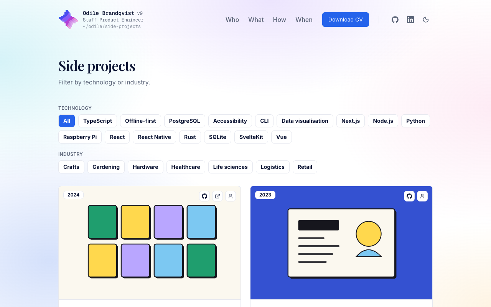</a><br>
<b>Side projects</b> (<code>/side-projects</code>): the same list with personal projects first, each with links to its code and live site.
</td>
<td valign="top" width="50%">
<a href="src/app/experience/page.tsx">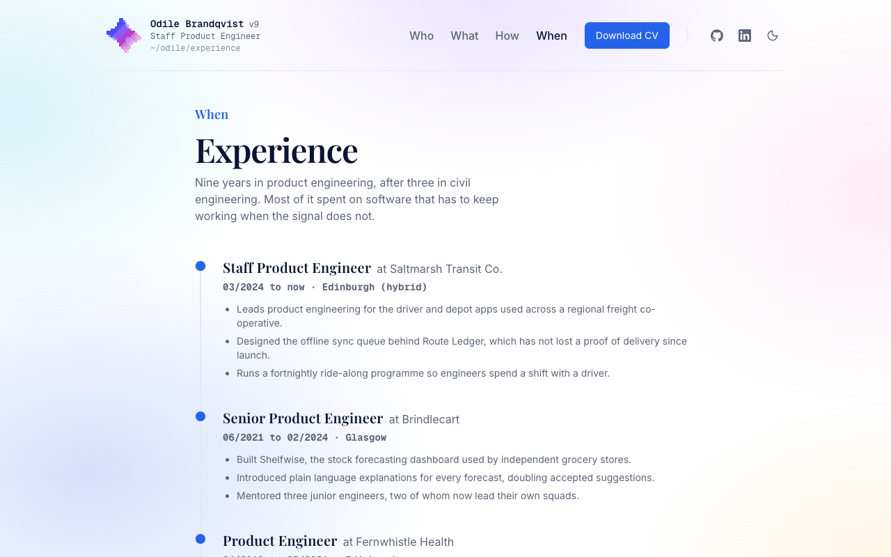</a><br>
<b>Experience</b> (<code>/experience</code>): a timeline of your roles with dates, places and highlights, from <code>content/experience.json</code> or <code>/admin</code>.
</td>
</tr>
<tr>
<td valign="top" width="50%">
<a href="src/app/admin">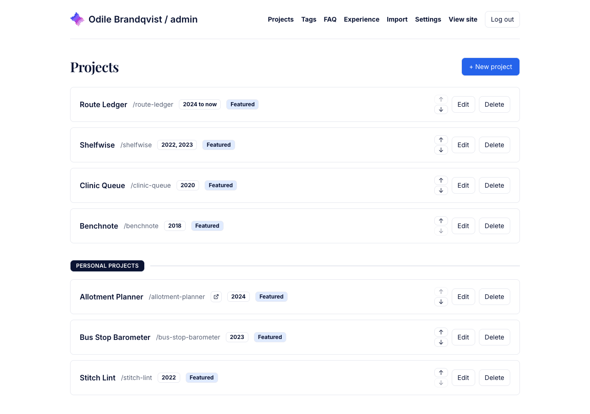</a><br>
<b>Admin panel</b> (<code>/admin</code>): a password protected editor for projects, tags, FAQs, experience and the site settings.
</td>
<td valign="top" width="50%">
<a href="src/app/admin/(protected)/settings/features/page.tsx">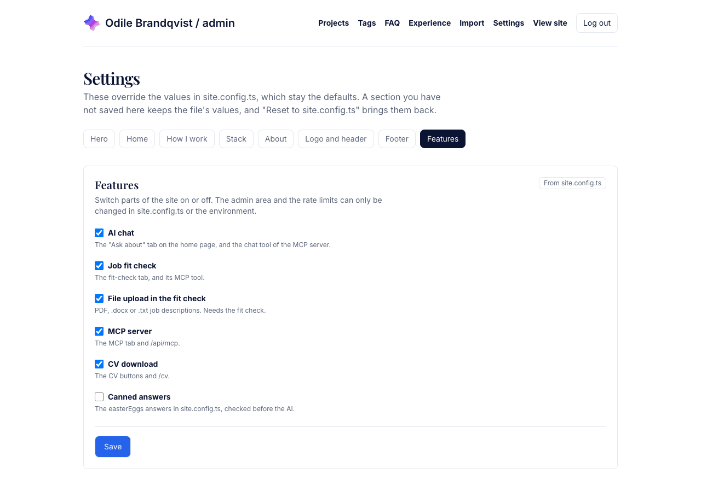</a><br>
<b>Features</b> (<code>/admin/settings/features</code>): switch the AI chat, the fit check, the MCP server, the CV download and canned answers on or off. <code>FEATURE_*</code> env vars still win.
</td>
</tr>
</table>

Every page also has a phone layout, with a menu in place of the header links:

<p>
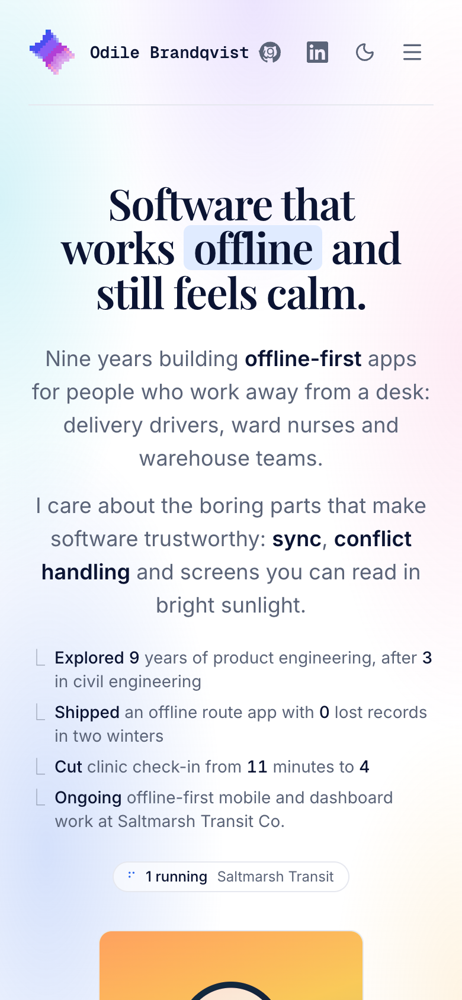
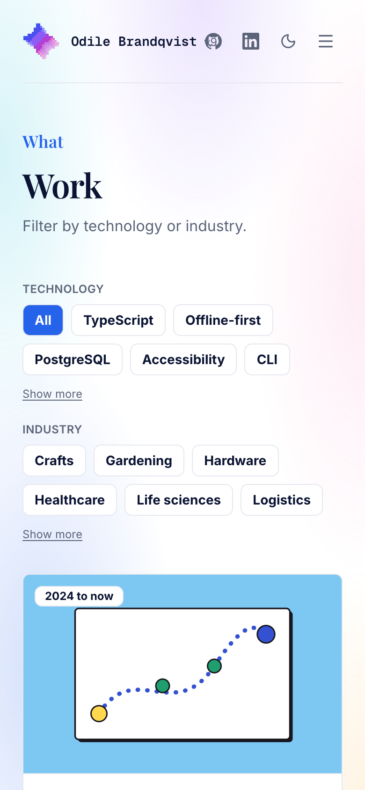
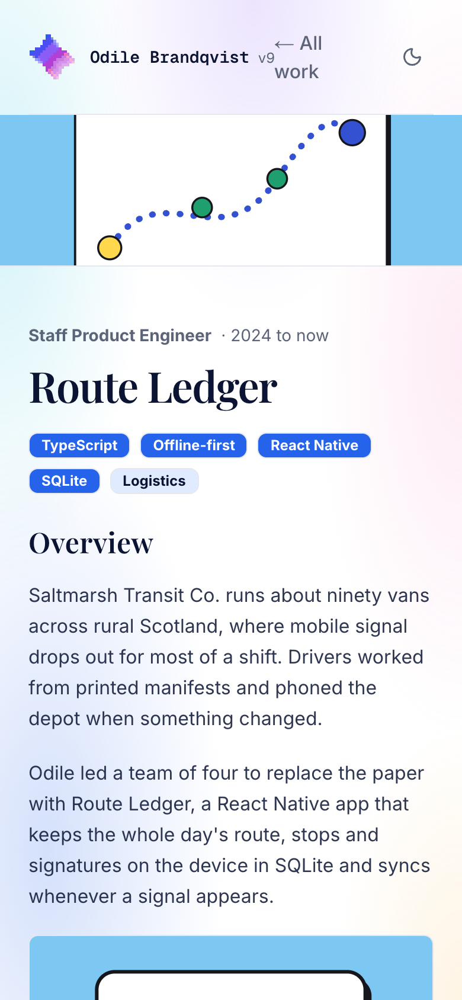
</p>

## How the portfolio works

| Part | Where it lives |
|---|---|
| Projects, experience, FAQs, tags | Postgres. Loaded from the JSON files in `content/` with `npm run db:seed`, or edited in `/admin`. |
| Name, contact links, SEO text, chat persona, colour theme | `site.config.ts`, one file for everything person-specific. |
| Hero, home sections, How I work, stack, About, logo, footer, feature flags | `site.config.ts` as the default, overridden by anything saved in `/admin/settings`. |
| Images | `public/`, with project images in `public/projects/<slug>/`. |
| CV | `public/cv.pdf`. |

Pages render on request, so an edit in `/admin` or a content script shows up on the next page load, with no rebuild. Details are in [Make it yours](#make-it-yours).

## The AI layer (optional)

The AI layer is optional. Each part has its own [feature flag](#feature-flags); switch all three off and you have a plain portfolio.

On the home page, visitors and recruiters get one panel with three tabs:

<table>
<tr>
<td valign="top" width="50%">
<a href="src/components/chat-panel.tsx">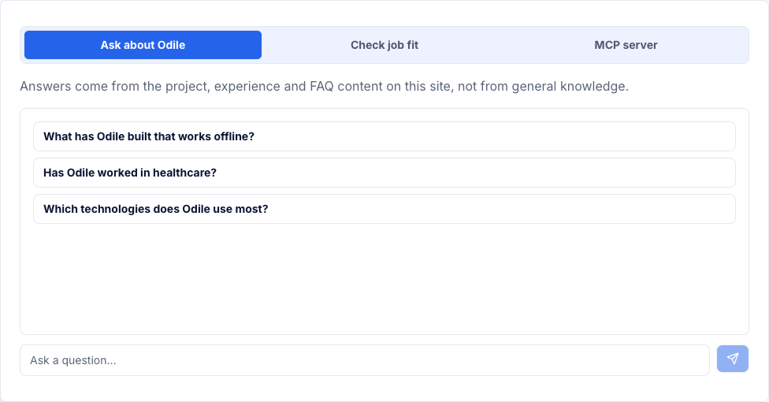</a><br>
<b>Chat</b>: visitors ask about your work and get answers taken only from your projects, experience and FAQs. Suggested questions come from <code>site.config.ts</code>.
</td>
<td valign="top" width="50%">
<a href="src/components/fit-check-panel.tsx">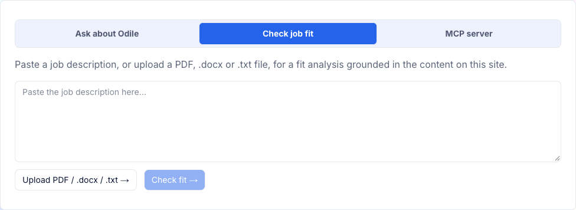</a><br>
<b>Fit check</b>: a recruiter pastes a job description (or uploads a PDF, .docx or .txt) and gets a verdict, strengths and gaps based on your content.
</td>
</tr>
<tr>
<td valign="top" width="50%">
<a href="src/components/mcp-panel.tsx">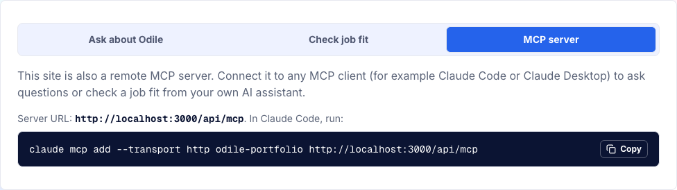</a><br>
<b>MCP server</b>: the site is also a remote MCP server, so an AI assistant such as Claude Code can ask about you, check a job fit and fetch your CV. See <a href="#mcp-usage">MCP usage</a>.
</td>
<td valign="top" width="50%">
</td>
</tr>
</table>

### How the AI layer works


1. Your content (projects, experience, FAQs) lives in Postgres. You load it from the JSON files in `content/` or edit it in `/admin`.
2. `npm run rag:ingest` splits that content into short chunks, turns each into an embedding (a list of 1536 numbers that captures its meaning) with your embedding provider (OpenAI by default), and stores them in a pgvector column.
3. When a visitor asks a question, the question is embedded the same way, the closest chunks are found by cosine distance, and only those chunks are given to the chat model as context.
4. The fit check does the same with a job description, and the model's JSON answer is validated before it is shown.
5. The MCP server wraps the same two functions as tools, so an AI assistant can query your portfolio directly.

Admin edits and the content scripts re-sync the index automatically. Only changed text is embedded again, so edits cost almost nothing.

## Deploy in one click

The [Deploy with Vercel](#set-it-up) button under Set it up copies this repo to your GitHub account, creates a free Neon database for it, and asks for three values: your AI API key (`AI_API_KEY`, an OpenAI key by default; see [Choosing an AI provider](#choosing-an-ai-provider) for others), a password for `/admin`, and a long random string for `SESSION_SECRET` (`openssl rand -base64 32`). The first deploy then sets the database up by itself: it creates the tables, loads the sample content and builds the chat's search index (see [What happens on deploy](#what-happens-on-deploy)). You get a working site with the sample persona; then [make it yours](#make-it-yours) and follow the [cost steps](#cost-and-security) before you share the link.

## Quick start

You need Node.js 20 or newer and, for the AI layer, an API key from an AI provider (OpenAI by default, see [Choosing an AI provider](#choosing-an-ai-provider)). Pick Neon (hosted) or Docker (local) for the database.

```bash
# Use "Use this template" on GitHub, or clone your fork:
git clone https://github.com/<your-username>/ai-portfolio-builder.git
cd ai-portfolio-builder
npm install
cp .env.example .env
```

### Option A: Neon (recommended, works with Vercel)

1. Create a free project at [neon.tech](https://neon.tech).
2. Copy its connection string into `DATABASE_URL` in `.env`. You do not need to enable anything by hand: the first migration creates the `vector` extension.

### Option B: Docker for local development

```bash
npm run db:up   # Postgres 17 with pgvector on localhost:5432
```

The default `DATABASE_URL` in `.env.example` already points at it. `npm run db:down` stops it.

### Then, for either option

1. Set `ADMIN_PASSWORD`, `SESSION_SECRET` (`openssl rand -base64 32`) and `AI_API_KEY` in `.env` (plus `AI_BASE_URL` and `CHAT_MODEL` for a provider other than OpenAI).
2. Create the tables, load the sample content and build the search index:

```bash
npm run db:migrate   # prisma migrate deploy
npm run db:seed      # loads content/ into the database
npm run rag:ingest   # embeds the content for the chat
npm run dev
```

Open http://localhost:3000.

### Deploy to Vercel by hand

1. Push your copy to GitHub and import it in Vercel.
2. Add the environment variables from `.env` (at least `DATABASE_URL`, `ADMIN_PASSWORD`, `SESSION_SECRET` and `AI_API_KEY`, plus any other `AI_*` and `EMBEDDING_*` values you use). `NEXT_PUBLIC_SITE_URL` is only needed for a custom domain; otherwise the Vercel production URL is used.
3. Deploy. The first build prepares the database, as below.
4. Before you share the link, follow the cost steps in [Cost and security](#cost-and-security).

### Deploy to Netlify

`netlify.toml` runs the same build as Vercel (`npm run vercel-build`). Add the same environment variables in Netlify; `NEXT_PUBLIC_SITE_URL` is only needed for a custom domain, otherwise Netlify's `URL` is used. Public pages are kept on Netlify's CDN for 5 minutes and refreshed in the background, so an edit in `/admin` could take up to 5 minutes to show; every admin save purges that cache when `NETLIFY_PURGE_API_TOKEN` and `SITE_ID` are set (see [Environment variables](#environment-variables)). PostHog events are proxied at Netlify's edge (see `netlify.toml`), because Next.js rewrites run in a function there and break the compressed event bodies.

### What happens on deploy

Vercel runs `npm run vercel-build` (`scripts/vercel-build.ts`), which runs these steps before the normal build:

1. `prisma migrate deploy`: creates or updates the tables and the `vector` extension. It uses `DATABASE_URL_UNPOOLED` when set (the Neon integration sets it), because migrations need a direct connection.
2. Loads the sample content from `content/`, **only while the database has no projects**, so it never overwrites or brings back what you changed in `/admin`.
3. `rag:ingest`: embeds only new or changed text, so a redeploy with no content changes costs nothing. If the key is missing or wrong, the build still succeeds and prints a warning; fix the key and redeploy. Without any AI key the chat, fit check and MCP server are switched off.

Without `DATABASE_URL` the steps are skipped and only the site is built. `npm run build` never touches the database, so local builds work offline. If you use Vercel preview deployments with the same database as production, previews run the same migrations against it; Neon's integration can give each preview its own database branch instead.

## Environment variables

| Variable | Required | Purpose |
|---|---|---|
| `DATABASE_URL` | Yes | Postgres with pgvector. Neon URLs use Neon's serverless driver, others use node-postgres. `DATABASE_DRIVER=neon` or `pg` forces one. |
| `ADMIN_PASSWORD` | For admin | Password for `/admin`. Refused in production while it is still the example value. |
| `SESSION_SECRET` | For admin | Signs the admin cookie. Changing it logs every session out. |
| `AI_API_KEY` | For AI features | Key for the chat model and, unless set separately, the embeddings. `OPENAI_API_KEY` still works in its place. Without a key (and without `AI_BASE_URL`) the chat, fit check and MCP server are off. |
| `AI_BASE_URL` | No | The provider's OpenAI-compatible endpoint. Empty means OpenAI. See [Choosing an AI provider](#choosing-an-ai-provider). |
| `CHAT_MODEL` | No | Defaults to `gpt-4.1-mini`. Set a model your provider offers. |
| `EMBEDDING_API_KEY`, `EMBEDDING_BASE_URL` | No | A separate provider for embeddings. Both fall back to the `AI_*` values; `EMBEDDING_API_KEY` on its own means OpenAI. |
| `EMBEDDING_MODEL` | No | Defaults to `text-embedding-3-small` (1536 dimensions). `none` switches embeddings, and with them the chat, fit check and MCP server, off. |
| `IMAGE_MODEL` | No | Draws blog covers, with OpenRouter only (`AI_BASE_URL="https://openrouter.ai/api/v1"`). Defaults to `bytedance-seed/seedream-5-5`, $0.02 per cover in November 2026. `none` switches covers off. |
| `ADMIN_MCP_TOKEN` | No | Switches on the private MCP server for blog drafts. At least 32 characters (`openssl rand -hex 32`). |
| `EMBEDDING_DIMENSIONS` | No | Sent as `dimensions`, for an embedding model that can shorten its output to 1536. |
| `NEXT_PUBLIC_SITE_URL` | No | Public URL; overrides `url` in `site.config.ts`. |
| `FEATURE_*` | No | Feature flag overrides, see below. |
| `RATE_LIMIT_PER_MINUTE`, `RATE_LIMIT_PER_DAY` | No | Per-IP limits for the AI endpoints. |
| `NEXT_PUBLIC_POSTHOG_KEY` | No | PostHog project API key (`phc_...`). Analytics stay off without it. Events go through `/ingest` on your own domain; `/admin` is never tracked and surveys are off. |
| `NETLIFY_PURGE_API_TOKEN`, `SITE_ID` | No | When both are set, every admin save purges Netlify's CDN cache, so the edit shows at once instead of within 5 minutes. Netlify provides them to the site's functions; if saves do not show at once, set them yourself (a personal access token and the site's ID). |
| `NEXT_PUBLIC_POSTHOG_REGION` | No | `eu` (default) or `us`, where your PostHog project lives. On Netlify, also change the `eu` hosts in `netlify.toml`. |
| `GITHUB_TOKEN` | No | Used by the profile import for a higher GitHub rate limit. Without it, GitHub allows 60 requests an hour. |

**About the embedding dimension:** the `Chunk.embedding` column is `vector(1536)`, the output size of `text-embedding-3-small`. If you switch to a model with a different size, change `vector(1536)` in `prisma/schema.prisma`, create a new migration, and run `npm run rag:ingest -- --full`.

### Choosing an AI provider

The AI layer talks to any OpenAI-compatible API. OpenAI is the default: set `AI_API_KEY` and nothing else. For another provider, set `AI_BASE_URL` and `CHAT_MODEL` too (`npm run setup` asks and fills them in). Old setups with `OPENAI_API_KEY` keep working.

| Provider | `AI_BASE_URL` | Example `CHAT_MODEL` | Embeddings |
|---|---|---|---|
| OpenAI | (empty) | `gpt-4.1-mini` | Yes: `text-embedding-3-small` |
| Anthropic (Claude) | `https://api.anthropic.com/v1/` | `claude-haiku-5-5` | No: use OpenAI with `EMBEDDING_API_KEY` |
| Google Gemini | `https://generativelanguage.googleapis.com/v1beta/openai/` | `gemini-3.8-flash` | Use OpenAI with `EMBEDDING_API_KEY`, or try `gemini-embedding-001` with `EMBEDDING_DIMENSIONS=1536` |
| OpenRouter | `https://openrouter.ai/api/v1` | `openai/gpt-4.1-mini` | Yes: `EMBEDDING_MODEL=openai/text-embedding-3-small` |
| Ollama (local only, not on Vercel) | `http://localhost:11434/v1/` | `gpt-oss:20b` (no key needed) | Only a model that returns 1536 numbers; otherwise use OpenAI with `EMBEDDING_API_KEY` |

Base URLs and models were checked against each provider's documentation in October 2026; model names change, so check your provider's model list.

Chat with Claude, embeddings with OpenAI:

```bash
AI_API_KEY="your Claude API key"
AI_BASE_URL="https://api.anthropic.com/v1/"
CHAT_MODEL="claude-haiku-5-5"
EMBEDDING_API_KEY="your OpenAI key"   # on its own, this means OpenAI embeddings
```

Not every provider honours JSON mode, so the fit check and the profile import ask for JSON, then read the first JSON object out of the answer and validate it before use. If no embedding provider is set up, the chat, fit check and MCP server switch themselves off; the rest of the site and the profile import still work.

## Make it yours

1. **`site.config.ts`** holds everything person-specific: name, initials, role, contact, socials, hero text, stats, journey, colour theme (see [Colour themes](#colour-themes)), chat persona and suggestions, fit-check criteria, MCP server name, CV file name, admin label, SEO and feature flags. Start here.
2. **`content/`** holds the sample content. Replace `content/projects/*.json` (same shape as `scripts/example-project.json`), `content/experience.json` and `content/faqs.json`, then run `npm run db:seed` and `npm run rag:ingest`. The seed upserts by slug, so remove the sample projects in `/admin` or with `npm run project:delete -- <slug>`.
3. **Images** go in `public/`. Project images live in `public/projects/<slug>/`; their sizes are measured at install and build time so covers of the right shape fill their card. Replace `public/avatar.svg` with your photo (and update `person.photo`).
4. **CV:** replace `public/cv.pdf` with your own.
5. **`/admin`** lets you edit all content in the browser once deployed. Every save updates the chat's search index in the background. In this version, **`/admin/settings`** also edits the hero, home sections, How I work, stack, About page, pixel logo, session block, footer and feature flags. Those values are stored in the database (the `SiteSettings` table) and override `site.config.ts`, which stays the default and the fallback when there is no database; "Reset to site.config.ts" removes a saved section. Your name, contact details, SEO text, chat persona, theme and the `admin` and `rateLimit` flags stay in `site.config.ts`. `FEATURE_*` env vars still win over the flags saved in the admin.
6. **Projects from the command line or a coding agent:** `npm run project:upsert -- path/to/project.json` creates or updates one project from a JSON file (same shape as `scripts/example-project.json`), and `npm run project:delete -- <slug>` removes one. Both re-sync the chat's search index straight away, so an AI coding assistant can manage your projects for you.

### Import from LinkedIn, CV and GitHub


Instead of typing everything, give the import your LinkedIn profile URL, a CV file (PDF, .docx or .txt, up to 5 MB) and your GitHub username. Each one is optional. It drafts your name, role, location, links, home page text (badge, headline, intro, stats, journey), SEO text, experience, FAQs and projects, and shows you a summary before anything is written.

* **What is read.** LinkedIn: your public profile page. CV: the text of the file. GitHub: your public profile and up to six of your own repositories that are not forks or archived (most stars first, then the most recently updated), with their descriptions, topics, languages and READMEs. `GITHUB_TOKEN` is used when set, for a higher rate limit.
* **LinkedIn is best effort.** LinkedIn often blocks automated reads. The import tries once, with no login and no retries, and tells you when it could not read the page. Then open your profile on LinkedIn, choose More, then Save to PDF, and give that PDF as your CV file instead.
* **Nothing is made up.** The model is told to use only facts from your sources and to leave anything unknown empty. Links, your email address and stat numbers that do not appear in your sources are dropped, and the summary lists what was left out. Check the draft anyway.
* **Privacy.** Your CV and profile text are sent to your AI provider with your own key (or read by your own coding agent). Nothing is stored except what you approve.
* **Cost.** One model call per draft, a few cents at most with the default OpenAI model.

Where to run it:

* `npm run setup` asks "Import from LinkedIn, CV and GitHub?" first. The draft becomes the default answer to each question, so you can still change any of them, and it writes `site.config.ts` and `content/`.
* On a deployed site, open `/admin/import`. It saves projects, experience and FAQs to the database, and gives you a `site.config.ts` snippet for your name and home page text to paste, commit and redeploy (a deployed site cannot change its own config). It uses the deployment's AI provider (`AI_API_KEY`).
* A coding agent can run `npm run import -- --linkedin <url> --cv <path> --github <user> --out draft.json`, show you the summary, and after your yes write it with `npm run import -- --apply draft.json`.

### The look

This version uses a minimal look: light borders, no hard shadows, serif headings and soft colour glows. The original template is neo-brutalist (thick outlines, hard shadows, flat bold colours); to bring the hard shadows back, set `--shadow-brutal` and its `-sm` and `-lg` variants in `src/app/globals.css`.

If you want a different look, you are not locked in. Open the project with your coding agent, give it screenshots or a design you like, and ask it to restyle the site. The colours live in `themes.ts`, the structure in `src/app/globals.css` and the components, so an agent can change either.

### Colour themes


Pick a theme in `site.config.ts` with one line, for example `theme: themes.slate`. Gradient is the default in this version (coral in the original), with `gradientDark` as `darkTheme`. The themes live in `themes.ts`. To change single colours, spread a theme and override what you need: `theme: { ...themes.coral, primary: "#b83a22" }`. Every button colour in the ready-made themes passes WCAG AA contrast (text stays readable on it). Links and highlighted words use a deeper shade of your primary colour, worked out at build time, so they stay readable even with light or pastel colours and your own custom values.

## Feature flags

Set in `site.config.ts` under `features`, or per deployment with environment variables (`true`/`false`), which win.

| Flag | Env var | Default | When off |
|---|---|---|---|
| `chat` | `FEATURE_CHAT` | on | Chat tab hidden, `/api/chat` returns 404, MCP chat tool removed |
| `fitCheck` | `FEATURE_FIT_CHECK` | on | Fit-check tab hidden, `/api/fit-check` returns 404, MCP tool removed |
| `parseJd` | `FEATURE_PARSE_JD` | on | File upload hidden, `/api/parse-jd` returns 404 (also off when `fitCheck` is off) |
| `mcp` | `FEATURE_MCP` | on | MCP tab hidden, `/api/mcp` returns 404 |
| `admin` | `FEATURE_ADMIN` | on | `/admin` returns 404 and every admin action refuses to run |
| `cv` | `FEATURE_CV` | on | CV buttons hidden, `/cv` returns 404 |
| `blog` | `FEATURE_BLOG` | off | `/blog`, post pages and the feed return 404, the Blog link is hidden; posts can still be written in the admin |
| `easterEggs` | `FEATURE_EASTER_EGGS` | off | Canned answers in `easterEggs` are ignored |
| `rateLimit` | `FEATURE_RATE_LIMIT` | on | No per-IP limits (not recommended in production) |

## Cost and security

The AI endpoints are public, so anyone can make the site spend your AI provider's credit. Each chat or fit-check call is one embedding plus one chat completion with roughly 1,500 to 3,000 input tokens: with the default OpenAI models a fraction of a cent, so the risk is volume, not single calls. Other providers and larger models cost more per call. Before you share the link:

1. **Set a monthly budget** with your AI provider for the key (for OpenAI: dashboard, project limits). This is the hard stop.
2. **Add a Vercel Firewall rate limit rule** for `/api/*` (Vercel dashboard, Firewall). The built-in limiter works per server instance, so it slows a single client down but is not a global cap.
3. Use a long random `ADMIN_PASSWORD` and `SESSION_SECRET`.

What the code already does: every admin server action checks the session itself (not only the `/admin` proxy); login attempts are rate limited and only redirect inside `/admin`; AI inputs have length caps (2,000 characters for questions, 8,000 for job descriptions, 5 MB for uploads); the prompts treat visitor text as data and refuse off-topic requests; the fit-check JSON is validated with zod; embeds run in a sandboxed iframe with an optional host allowlist (`embeds.allowedHosts`). Sessions last 7 days and cannot be revoked one by one; rotate `SESSION_SECRET` to log everyone out.

The fit check is a guide, not proof: it only knows what is on your site, and the page says so.

See [SECURITY.md](SECURITY.md) to report a vulnerability.

## MCP usage

With `mcp` on, your deployed site is a remote MCP server (Streamable HTTP) at `https://your-domain/api/mcp` with these tools:

| Tool | Input |
|---|---|
| `ask_about_<firstName>` | `question` (up to 2,000 characters) |
| `check_job_fit` | `jobDescription` (20 to 8,000 characters) |
| `get_cv` | none, returns the `/cv` link |

Connect it from Claude Code:

```bash
claude mcp add --transport http your-portfolio https://your-domain/api/mcp
```

Other MCP clients that support remote HTTP servers take the same URL. MCP calls share the per-IP rate limits of the site.

### Write posts from Claude Code

A second, private MCP server at `/api/mcp/admin` lets Claude Code write blog drafts: `list_posts`, `get_post`, `create_draft`, `update_draft` and, with OpenRouter, `make_cover`. On purpose there is no tool to publish, unpublish, delete or change a live post: you do that in `/admin/posts`. It is off until `ADMIN_MCP_TOKEN` is set.

```bash
claude mcp add --transport http my-blog https://your-domain/api/mcp/admin --header "Authorization: Bearer YOUR_TOKEN"
```

Keep the token as private as your admin password. An agent can read a web page or file that tries to steer it, and can pick up confidential details from its session, so read every draft before you publish. Put your own limits in `blog.draftRules` in `site.config.ts`.

## Project structure

```
site.config.ts        everything person-specific, plus feature flags
content/              sample projects, experience and FAQs (JSON)
prisma/               schema, migrations, seed (loads content/)
scripts/              setup, profile import, ingest, project upsert and delete, cover measuring
src/app/              pages, admin, API routes (chat, fit-check, parse-jd, mcp), /cv
src/components/       UI, including shadcn/ui primitives in ui/
src/lib/              config, RAG, index sync, auth, rate limiting, content blocks, profile import
public/               avatar, sample CV, project images, embed video player
docker-compose.yml    local Postgres with pgvector
```

## Tips

* Prisma publishes agent skills for working with Prisma; install them with your agent's skills tooling if you use an AI coding assistant.
* `npm run rag:ingest -- --full` re-embeds everything (after a model change).
* Content written by scripts appears immediately, because content pages render on request.

## Credits

* [shadcn/ui](https://ui.shadcn.com) for the UI primitives in `src/components/ui/` (MIT).
* [neobrutalism.dev](https://www.neobrutalism.dev) ([neobrutalism-components](https://github.com/ekmas/neobrutalism-components), MIT, by Samuel Breznjak) for the neo-brutalist border, shadow and radius structure.
* Several themes are adapted from the [neobrutalism palettes collected on colorany.com](https://colorany.com/color-palettes/neobrutalism-color-palettes/).
* [Simple Icons](https://simpleicons.org) for the GitHub mark (CC0).
* Inter, Playfair Display and Geist Mono fonts (SIL Open Font License), via `next/font`; Inter and Playfair Display are also bundled in `src/app/og-fonts/` for the share image.
* [Anime.js](https://animejs.com) for the motion (MIT).
* Built on Next.js, React, Prisma, pgvector, Tailwind CSS, OpenAI, mcp-handler, unpdf and mammoth.

## Licence

Free and open source.

Code: [MIT](LICENSE). Sample content (everything in `content/`, the sample CV, avatar and project images in `public/`) is released under [CC0](https://creativecommons.org/publicdomain/zero/1.0/): use it freely while you test. The sample persona and every company and project in it are fictional; any resemblance to real people or businesses is a coincidence.

## About

This fork is maintained by Hakan Baybaş. The original template is by Mehmet Mutlu, [mehmetmutlu.dev](https://www.mehmetmutlu.dev). If it helps you, you can support it on [GitHub Sponsors](https://github.com/sponsors/mutlumehmet) or [Buy Me a Coffee](https://buymeacoffee.com/mutlumehmet).
